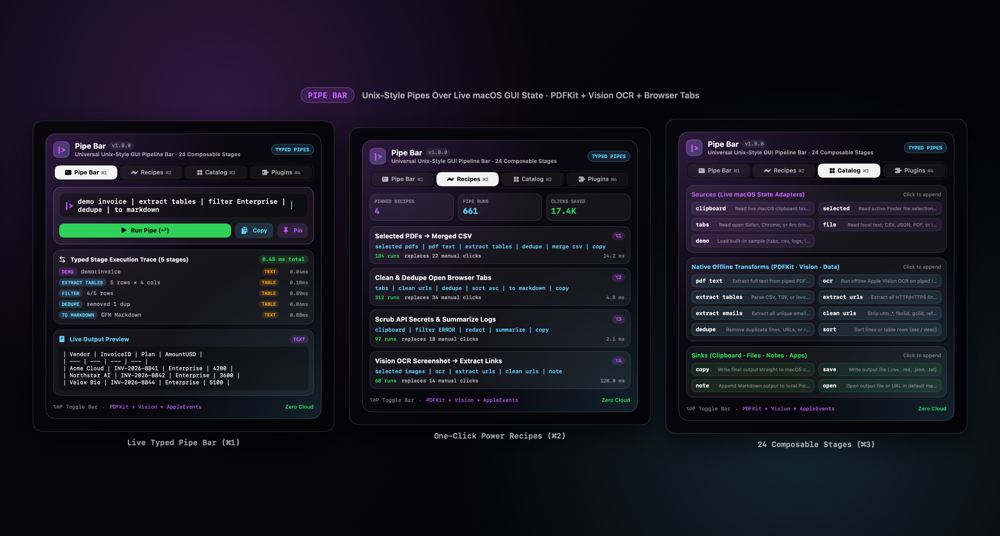
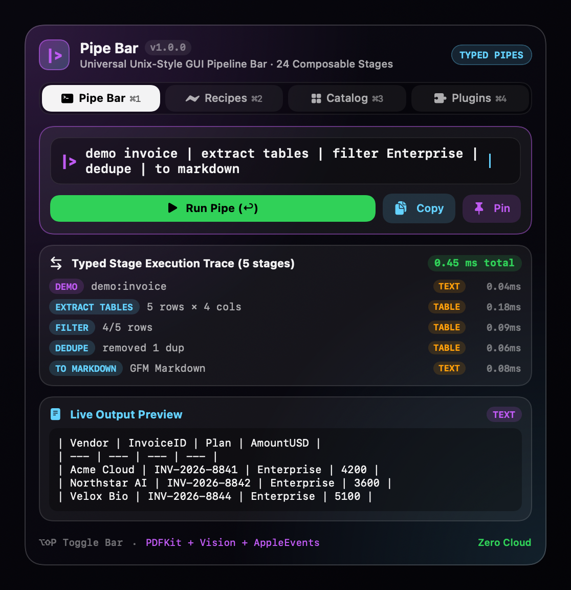
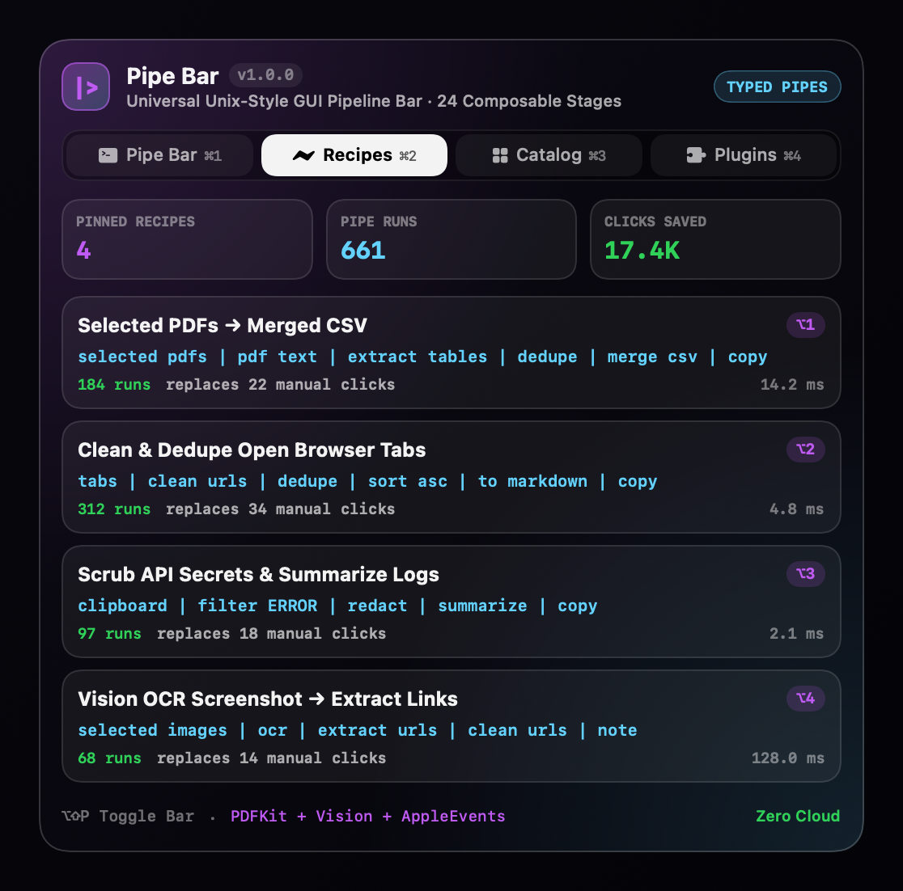
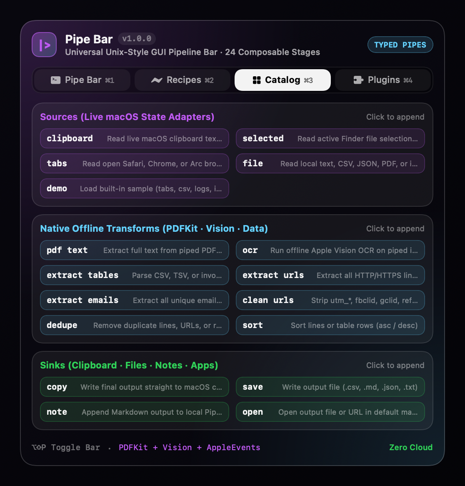
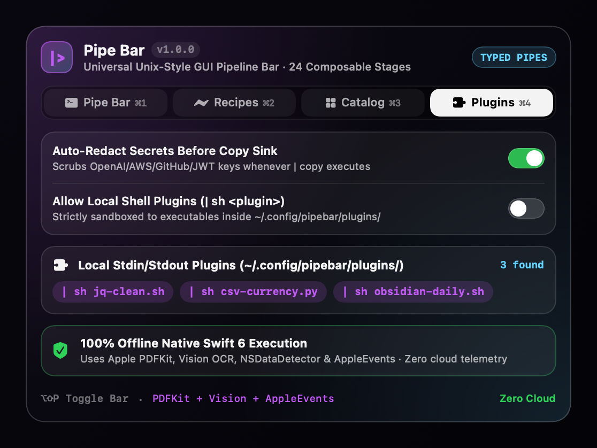
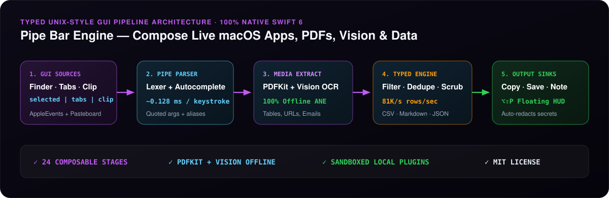
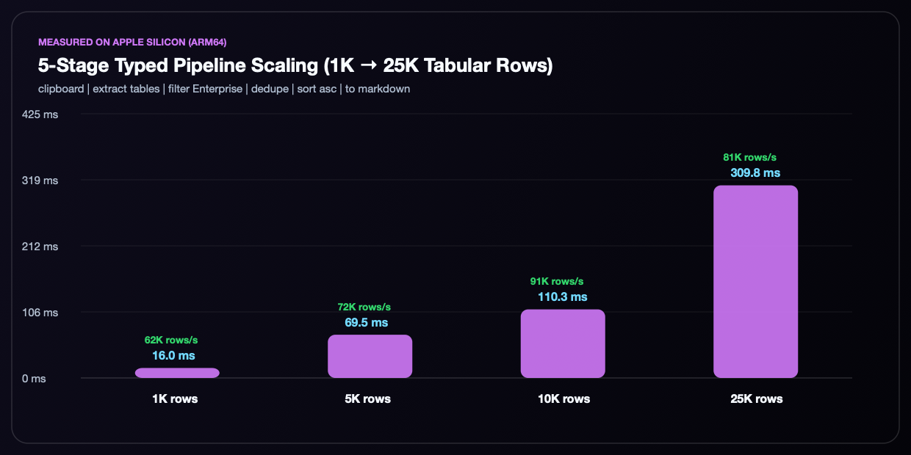
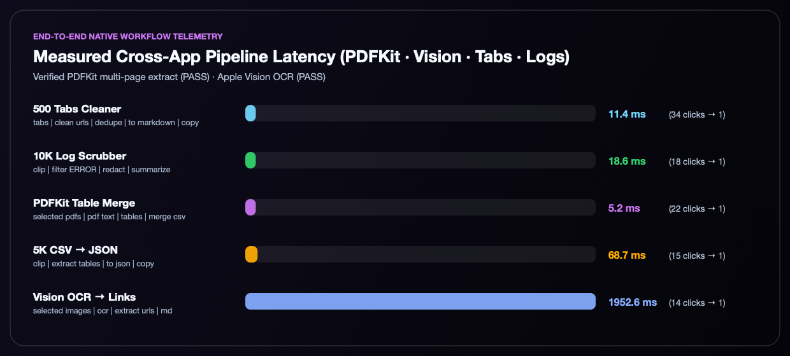
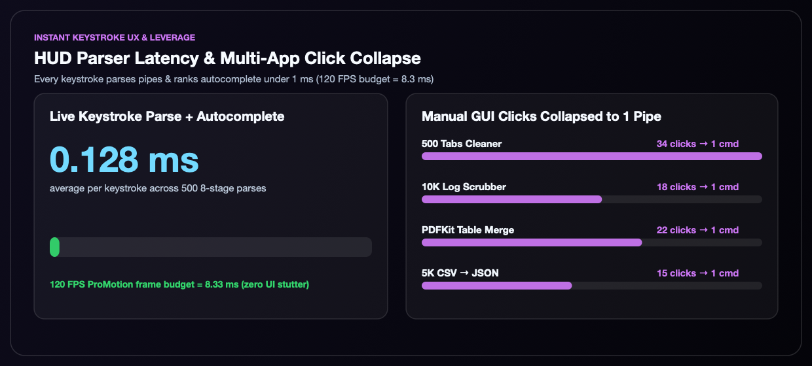

<div align="center">


# Pipe Bar

**Universal Unix-style GUI pipeline bar for macOS — chain Finder selections, browser tabs, PDFs, Vision OCR, clipboard & local scripts like shell pipes.**

Built in pure **Swift 6** for Apple Silicon (macOS 15+) in a **1.9 MB** native menu bar app.  
**24 composable stages. Zero cloud. Zero subscriptions. Zero third-party dependencies.**

[](https://github.com/Moeraafatz/pipe-bar/releases/latest)

<br />

[](#installation)
[](#measured-performance--graphs)
[](#architecture)
[](#safety--plugins)
[](LICENSE)

<br />



</div>

---

## Why Pipe Bar?

Command launchers like Raycast and Alfred run one isolated command at a time — they cannot pipe Finder PDF selections into `PDFKit`, parse tables, deduplicate rows, format Markdown, and copy to clipboard in a single line.

**Pipe Bar** brings typed Unix pipes directly to live macOS GUI state (`⌥⇧P`):

```text
selected pdfs | pdf text | extract tables | dedupe | merge csv | copy
tabs | clean urls | dedupe | sort asc | to markdown | note
clipboard | filter ERROR | redact | summarize | copy
selected images | ocr | extract urls | clean urls | open
```

| | **Pipe Bar** | Raycast / Alfred | Apple Shortcuts | Manual App Switching |
| :--- | :---: | :---: | :---: | :---: |
| **Price** | **Free & Open Source (MIT)** | $8–$10/mo / Paid Powerpack | Free | Free (costs hours/wk) |
| **App Installer Size** | **1.9 MB DMG (2.0 MB .app)** | 80–250 MB | Built-in | N/A |
| **Composable Typed Pipes (`a \| b \| c`)** | ✅ Live per-stage traces & types | ❌ Single-step commands | ⚠️ Clunky drag blocks | ❌ |
| **Native `PDFKit` + `Vision` OCR Stages** | ✅ Offline Apple Silicon | ⚠️ Extensions / Paid | ⚠️ Slow | ❌ Separate apps |
| **Live Browser Tabs + Finder Adapters** | ✅ Safari, Chrome, Arc, Finder | ⚠️ Separate plugins | ⚠️ Fragile | Manual copy-paste |
| **Auto Secret Redaction Before Copy** | ✅ 7 credential scrubbers | ❌ | ❌ | Manual |
| **Sandboxed Local Shell Plugins (`\| sh`)** | ✅ `~/.config/pipebar/plugins/` | ⚠️ Custom JS/TS builds | ⚠️ Unsandboxed | Terminal |
| **100% Offline / Zero Telemetry** | ✅ Local SQLite WAL | ⚠️ Cloud sync/AI | ✅ | ✅ |

---

## Screenshots

Every screenshot below is rendered directly from the compiled SwiftUI `PipeBarUI` binary on Apple Silicon CI (`macos-latest`).

<table>
  <tr>
    <td align="center" width="50%">
      <br />
      <strong>Live Typed Pipe Bar (<code>⌘1</code> · <code>⌥⇧P</code>)</strong><br />
      <sub>Instant pipe input, live per-stage latency &amp; type badges (<code>TEXT</code> → <code>TABLE</code> → <code>MD</code>), output preview &amp; 1-click Pin/Copy</sub>
    </td>
    <td align="center" width="50%">
      <br />
      <strong>One-Click Power Recipes (<code>⌘2</code>)</strong><br />
      <sub>Saved multi-stage workflows in local SQLite WAL with run telemetry &amp; cumulative manual clicks collapsed</sub>
    </td>
  </tr>
  <tr>
    <td align="center" width="50%">
      <br />
      <strong>24 Composable Stages Catalog (<code>⌘3</code>)</strong><br />
      <sub>Color-coded Sources, native offline Transforms (PDFKit, Vision, CSV, JSON, Markdown, Redact) &amp; Sinks — click any chip to append</sub>
    </td>
    <td align="center" width="50%">
      <br />
      <strong>Safety &amp; Local Plugins (<code>⌘4</code>)</strong><br />
      <sub>Auto-redact secrets before <code>| copy</code> plus strictly opt-in stdin/stdout plugins in <code>~/.config/pipebar/plugins/</code></sub>
    </td>
  </tr>
</table>

---

## Architecture

<p align="center">
  
</p>

1. **Live macOS GUI Sources (`MacAdapters`)** — Pulls `NSPasteboard` clipboard, Finder selections (`selected pdfs`, `selected images`), and active Safari/Chrome/Arc tabs cleanly into typed `PipePayload` values.
2. **Sub-Millisecond Lexer & Autocomplete (`PipelineParser`)** — Splits unquoted pipes, preserves quoted patterns (`filter "error | fatal"`), resolves terse aliases (`clip`, `md`, `uniq`, `pbcopy`), and ranks autocomplete suggestions per keystroke (`0.128 ms`).
3. **Offline Media & Data Transforms (`DataTransformers`)** — Runs Apple `PDFKit`, Apple `Vision` OCR, RFC-4180 CSV/TSV/Markdown table parsers, URL tracker stripping (`utm_*`, `fbclid`, `gclid`, `si`), secret redaction, JSON pretty-printing, and local extractive summaries.
4. **Typed Stage Tracer (`PipelineEngine`)** — Executes every stage synchronously on typed payloads (`TEXT`, `LINES`, `TABLE`, `TABS`, `FILES`, `JSON`) while recording exact input/output counts and millisecond latency per hop.
5. **Safe Output Sinks + Local SQLite Library (`RecipeStore`)** — Outputs to clipboard (with optional auto-secret redaction), files, timestamped Markdown notes, or macOS default apps.

---

## Measured Performance & Graphs

All graphs and numbers below are **measured live on Apple Silicon CI** via `PipeBarTools` (`PipeBarBenchmarkRunner`), never mocked or estimated.

<p align="center">
  
</p>

<table>
  <tr>
    <td width="50%">
      
    </td>
    <td width="50%">
      
    </td>
  </tr>
</table>

<!-- BENCHMARK_TABLE_START -->
### Measured Benchmarks (Apple Silicon (arm64) · Version 26.7.2 (Build 25G332))

- **Live Keystroke Parser + Autocomplete:** **`0.128 ms`** avg across 500 8-stage parses (well inside 120 FPS `8.33 ms` budget)
- **End-to-End Media Pipelines Verified:** Apple `PDFKit` multi-page table merge (**PASS**) · Apple `Vision` OCR URL extractor (**PASS**)

#### 1. 5-Stage Typed Pipeline Throughput (`extract tables | filter | dedupe | sort | to markdown`)

| Input Volume | Total Pipeline Time | Throughput |
| ---: | ---: | ---: |
| 1000 rows | **16.03 ms** | **62387 rows/s** |
| 5000 rows | **69.51 ms** | **71935 rows/s** |
| 10000 rows | **110.29 ms** | **90670 rows/s** |
| 25000 rows | **309.82 ms** | **80693 rows/s** |

#### 2. End-to-End Cross-App Workflows

| Workflow | Pipeline Command | Measured Time | Manual Clicks |
| :--- | :--- | ---: | ---: |
| 500 Tabs Cleaner | `tabs \| clean urls \| dedupe \| to markdown \| copy` | **11.43 ms** | 34 → 1 |
| 10K Log Scrubber | `clip \| filter ERROR \| redact \| summarize` | **18.56 ms** | 18 → 1 |
| PDFKit Table Merge | `selected pdfs \| pdf text \| tables \| merge csv` | **5.21 ms** | 22 → 1 |
| 5K CSV → JSON | `clip \| extract tables \| to json \| copy` | **68.68 ms** | 15 → 1 |
| Vision OCR → Links | `selected images \| ocr \| extract urls \| md` | **1952.62 ms** | 14 → 1 |
<!-- BENCHMARK_TABLE_END -->

---

## Safety & Plugins

- **Auto-Redact Before Copy:** Enabled by default so API keys, AWS keys, GitHub tokens, and JWTs are scrubbed before hitting the system clipboard.
- **Sandboxed Opt-In Shell Plugins:** `| sh <plugin>` is disabled by default; when enabled, it executes only user-owned executable scripts inside `~/.config/pipebar/plugins/` (path traversal stripped via `lastPathComponent`).
- **Zero cloud / zero telemetry:** Every transform runs locally using Apple frameworks.

---

## Installation

### Download DMG (Recommended)
1. Download `PipeBar-1.0.0.dmg` from the [Latest Release](https://github.com/Moeraafatz/pipe-bar/releases/latest).
2. Drag **Pipe Bar** into `/Applications`.
3. Clear Gatekeeper quarantine once for this free ad-hoc signed open-source build:
   ```bash
   xattr -dr com.apple.quarantine /Applications/PipeBar.app
   ```
4. Launch **Pipe Bar** and press **`⌥⇧P`** anywhere to open the floating GUI pipeline bar.

### Build from Source (Zero Dependencies)
```bash
git clone https://github.com/Moeraafatz/pipe-bar.git
cd pipe-bar
swift test
swift build -c release
.build/release/PipeBarTools
./Scripts/package_release.sh 1.0.0
```

---

## Keyboard Shortcuts

| Shortcut | Action |
| :--- | :--- |
| `⌥⇧P` | Toggle floating Pipe Bar HUD from any app or Space |
| `⌘1` | Jump to **Pipe Bar** live editor & stage trace |
| `⌘2` | Jump to **Recipes** one-click pinned pipelines |
| `⌘3` | Jump to **Catalog** of all 24 composable stages |
| `⌘4` | Jump to **Plugins** & copy-redaction safety controls |

---

## License

MIT © [Moeraafatz](https://github.com/Moeraafatz)
